# ambientCG: Rocks materials

**23 assets from [ambientCG](https://ambientcg.com), dedicated to the public domain under [CC0](https://docs.ambientcg.com/license/).** Use them in any game, free or paid, and change them however you like; no credit is needed.

PBR materials as 1K and 2K JPG maps (colour, normal GL and DX, roughness, AO, displacement), one folder per resolution. 866.2 MB in all.

This is a copy kept by [zuujis-cc0](https://github.com/zuujis-cc0) so game makers can take single files from GitHub. It is not made by or affiliated with ambientCG: the originals, often in more formats and higher resolutions, are on [ambientcg.com](https://ambientcg.com). If they help you, consider [supporting ambientCG](https://www.patreon.com/ambientCG).

Every file is listed in [MANIFEST.tsv](MANIFEST.tsv) with its size and SHA-256. More free assets: [the Zuujis collection](https://github.com/zuujis-cc0/free-game-assets#readme).

| | | | |
| :-: | :-: | :-: | :-: |
| <a href="Rocks001">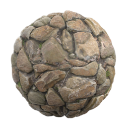</a> <b><a href="Rocks001">Rocks 001</a></b> by ambientCG · <a href="https://ambientcg.com/a/Rocks001">source</a> | <a href="Rocks002">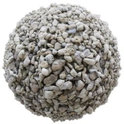</a> <b><a href="Rocks002">Rocks 002</a></b> by ambientCG · <a href="https://ambientcg.com/a/Rocks002">source</a> | <a href="Rocks003">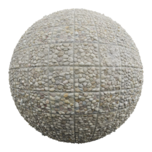</a> <b><a href="Rocks003">Rocks 003</a></b> by ambientCG · <a href="https://ambientcg.com/a/Rocks003">source</a> | <a href="Rocks004">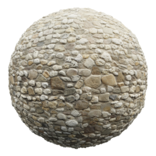</a> <b><a href="Rocks004">Rocks 004</a></b> by ambientCG · <a href="https://ambientcg.com/a/Rocks004">source</a> |
| <a href="Rocks005">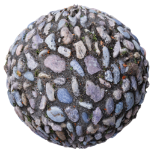</a> <b><a href="Rocks005">Rocks 005</a></b> by ambientCG · <a href="https://ambientcg.com/a/Rocks005">source</a> | <a href="Rocks006">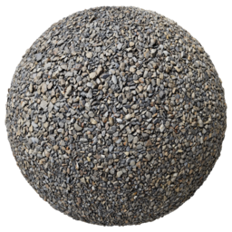</a> <b><a href="Rocks006">Rocks 006</a></b> by ambientCG · <a href="https://ambientcg.com/a/Rocks006">source</a> | <a href="Rocks007">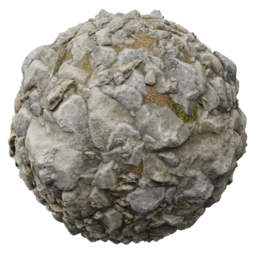</a> <b><a href="Rocks007">Rocks 007</a></b> by ambientCG · <a href="https://ambientcg.com/a/Rocks007">source</a> | <a href="Rocks008">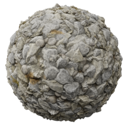</a> <b><a href="Rocks008">Rocks 008</a></b> by ambientCG · <a href="https://ambientcg.com/a/Rocks008">source</a> |
| <a href="Rocks009">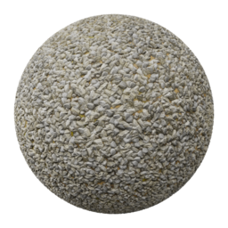</a> <b><a href="Rocks009">Rocks 009</a></b> by ambientCG · <a href="https://ambientcg.com/a/Rocks009">source</a> | <a href="Rocks010">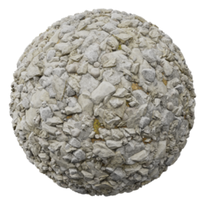</a> <b><a href="Rocks010">Rocks 010</a></b> by ambientCG · <a href="https://ambientcg.com/a/Rocks010">source</a> | <a href="Rocks011">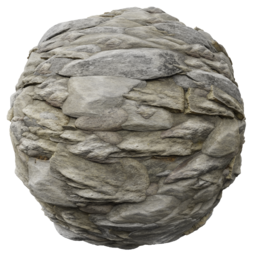</a> <b><a href="Rocks011">Rocks 011</a></b> by ambientCG · <a href="https://ambientcg.com/a/Rocks011">source</a> | <a href="Rocks012">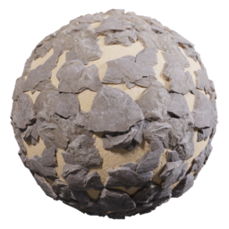</a> <b><a href="Rocks012">Rocks 012</a></b> by ambientCG · <a href="https://ambientcg.com/a/Rocks012">source</a> |
| <a href="Rocks013">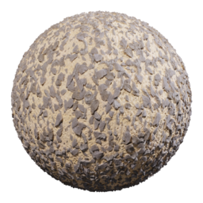</a> <b><a href="Rocks013">Rocks 013</a></b> by ambientCG · <a href="https://ambientcg.com/a/Rocks013">source</a> | <a href="Rocks014">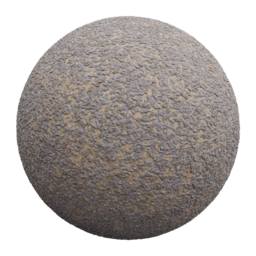</a> <b><a href="Rocks014">Rocks 014</a></b> by ambientCG · <a href="https://ambientcg.com/a/Rocks014">source</a> | <a href="Rocks015">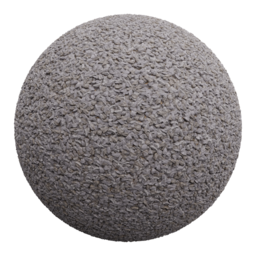</a> <b><a href="Rocks015">Rocks 015</a></b> by ambientCG · <a href="https://ambientcg.com/a/Rocks015">source</a> | <a href="Rocks016">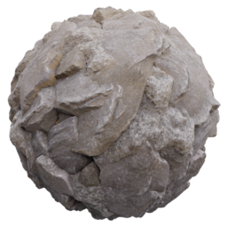</a> <b><a href="Rocks016">Rocks 016</a></b> by ambientCG · <a href="https://ambientcg.com/a/Rocks016">source</a> |
| <a href="Rocks017">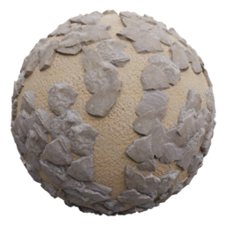</a> <b><a href="Rocks017">Rocks 017</a></b> by ambientCG · <a href="https://ambientcg.com/a/Rocks017">source</a> | <a href="Rocks018">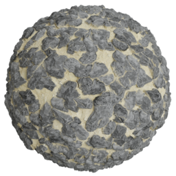</a> <b><a href="Rocks018">Rocks 018</a></b> by ambientCG · <a href="https://ambientcg.com/a/Rocks018">source</a> | <a href="Rocks019">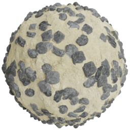</a> <b><a href="Rocks019">Rocks 019</a></b> by ambientCG · <a href="https://ambientcg.com/a/Rocks019">source</a> | <a href="Rocks020">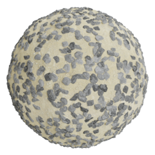</a> <b><a href="Rocks020">Rocks 020</a></b> by ambientCG · <a href="https://ambientcg.com/a/Rocks020">source</a> |
| <a href="Rocks021">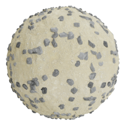</a> <b><a href="Rocks021">Rocks 021</a></b> by ambientCG · <a href="https://ambientcg.com/a/Rocks021">source</a> | <a href="Rocks022">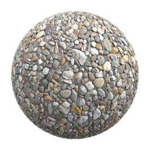</a> <b><a href="Rocks022">Rocks 022</a></b> by ambientCG · <a href="https://ambientcg.com/a/Rocks022">source</a> | <a href="Rocks023">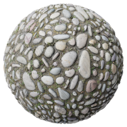</a> <b><a href="Rocks023">Rocks 023</a></b> by ambientCG · <a href="https://ambientcg.com/a/Rocks023">source</a> |  |

---

Kept up to date by this repository's own [update workflow](.github/workflows/update.yml), with code and plan from [cc0-mirror](https://github.com/zuujis-cc0/cc0-mirror). Something wrong? [Open an issue there](https://github.com/zuujis-cc0/cc0-mirror/issues/new) or use the [private report form](https://games.zuujis.com/report).
